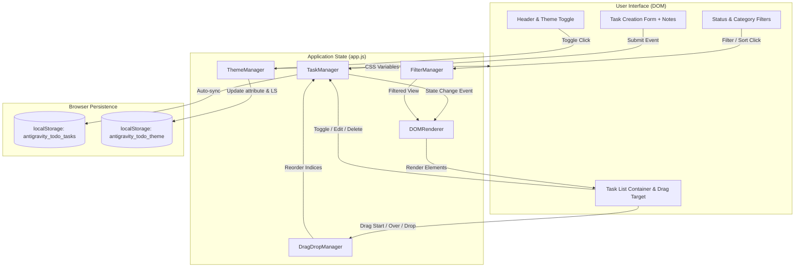

# Implementation Plan: Modern To-Do List Application

## 1. Objective
Build and verify a high-performance, client-side To-Do List web application adhering to the approved [requirements.md](file:///C:/Users/Ahad/.gemini/antigravity-ide/scratch/todo-app/requirements.md). The application provides task CRUD with in-place editing, native drag-and-drop reordering, Light/Dark theme switching, expandable task notes, priority badges, category filtering, and persistent browser storage.

---

## 2. Implementation Goal
Deliver a production-ready, zero-dependency web application inside `scratch/todo-app/` comprising:
- `index.html`: Accessible, semantic DOM structure with header controls, task creation form, category filter bar, and task list container.
- `style.css`: Design system tokens for Light and Dark themes, smooth micro-interactions, responsive grid/flexbox layouts, and drag-and-drop feedback states.
- `app.js`: Modular client architecture containing `StorageAdapter`, `ThemeManager`, `TaskManager`, `DragDropManager`, and `DOMRenderer`.

---

## 3. Scope

### In-Scope
- Task creation with title, notes, priority (Low/Medium/High), category (Work/Personal/Dev/Urgent), and due date.
- In-place title and notes editing (<kbd>Enter</kbd> to save, <kbd>Esc</kbd> to cancel).
- Native HTML5 drag-and-drop reordering with immediate order persistence in `localStorage`.
- Light and Dark mode switching with system preference detection (`prefers-color-scheme`) and persistent preference.
- Expandable/collapsible notes accordion on each task card.
- Filter toolbar (All / Active / Completed / Category chips) and sorting engine.
- Persistent `localStorage` state with default starter tasks and safe JSON parsing.

### Out-of-Scope
- Backend REST/GraphQL servers or external databases (pure client-side per spec).
- User authentication / cloud synchronization.
- Heavy external UI frameworks (React, Vue, Tailwind) — built with clean Vanilla HTML5/CSS3/ES6+.

---

## 4. Architecture Diagram

```
┌──────────────────────────────────────────────────────────────────────────────────┐
│                           USER INTERFACE (HTML5 / DOM)                           │
│                                                                                  │
│   ┌────────────────────────┐         ┌───────────────────────────────────────┐   │
│   │  Header & Theme Toggle │         │  Task Creation Bar + Notes Input      │   │
│   │  (☀️ Light / 🌙 Dark)  │         │  (Title, Priority, Category, Date)    │   │
│   └───────────┬────────────┘         └───────────────────┬───────────────────┘   │
│               │ Toggle Theme                             │ Submit Task           │
│   ┌───────────▼────────────┐         ┌───────────────────▼───────────────────┐   │
│   │  Filter & Sort Bar     │         │  Task Cards Container                 │   │
│   │  (All/Active/Done/Tags)│         │  (Drag-Handle, Checkbox, Notes, Edit) │   │
│   └───────────┬────────────┘         └───────────────────▲───────────────────┘   │
└───────────────┼──────────────────────────────────────────┼───────────────────────┘
                │ Filter Click                             │ Re-render DOM
                ▼                                          │
┌──────────────────────────────────────────────────────────┼───────────────────────┐
│                        APPLICATION LOGIC (app.js)        │                       │
│                                                          │                       │
│   ┌───────────────────┐  ┌───────────────────┐  ┌────────┴──────────┐  ┌─────┴─┐ │
│   │   ThemeManager    │  │   FilterManager   │  │   TaskManager     │  │DragDrop│ │
│   │                   │  │                   │  │                   │  │Manager │ │
│   │ • CSS data-theme  │  │ • Status filter   │  │ • Add, Edit, Del  │  │• Reorder│
│   │ • OS auto-detect  │  │ • Category chips  │  │ • Toggle complete │  │• Guides│ │
│   └─────────┬─────────┘  └─────────┬─────────┘  └────────┬──────────┘  └───┬───┘ │
│             │                      │                     │                 │     │
│             │                      └──────────┬──────────┘                 │     │
│             │                                 ▼ Event Trigger              │     │
│             │                          [ Task State Updated ] ◄────────────┘     │
└─────────────┼─────────────────────────────────┼──────────────────────────────────┘
              │ Read / Save                     │ Auto-Sync on Every Mutation
              ▼                                 ▼
┌──────────────────────────────────────────────────────────────────────────────────┐
│                          BROWSER STORAGE (localStorage)                          │
│                                                                                  │
│      Key: "antigravity_todo_theme"          Key: "antigravity_todo_tasks"        │
│      Value: "dark" | "light"                Value: JSON Array of Task Objects    │
└──────────────────────────────────────────────────────────────────────────────────┘
```



---

## 5. Data Access Pattern

### LocalStorage Keys
1. **`antigravity_todo_tasks`**: JSON array of `Task` objects.
2. **`antigravity_todo_theme`**: String value (`"dark"` or `"light"`).

### Read Operations
- **App Startup**: Inlined script in `<head>` reads `antigravity_todo_theme` or falls back to `window.matchMedia('(prefers-color-scheme: dark)')` to prevent theme flash.
- **Data Hydration**: `loadTasks()` parses `antigravity_todo_tasks`. If absent or invalid, initializes with 4 curated starter tasks demonstrating categories, priorities, notes, and due dates.

### Write Operations
- **Single Source of Truth**: All mutations (create, edit, toggle, delete, reorder) pass through `TaskManager`, which triggers `saveTasks()`.
- **Fault-Tolerant Serialization**: Wrapped in `try...catch` to handle quota exceeded errors gracefully.

---

## 6. API Design (Internal Module Contracts)

### `StorageAdapter`
```javascript
const StorageAdapter = {
  getTasks(): Task[],
  saveTasks(tasks: Task[]): boolean,
  getTheme(): string | null,
  saveTheme(theme: string): void
};
```

### `TaskManager`
```javascript
const TaskManager = {
  addTask(data: { title: string, notes?: string, category: string, priority: string, dueDate?: string }): Task,
  updateTask(id: string, updates: Partial<Task>): Task | null,
  deleteTask(id: string): boolean,
  toggleComplete(id: string): boolean,
  reorderTasks(sourceIndex: number, targetIndex: number): void,
  clearCompleted(): void
};
```

### `DragDropManager`
```javascript
const DragDropManager = {
  bindDraggable(element: HTMLElement, index: number): void,
  handleDragStart(e: DragEvent): void,
  handleDragOver(e: DragEvent): void,
  handleDrop(e: DragEvent): void,
  handleDragEnd(e: DragEvent): void
};
```

### `ThemeManager`
```javascript
const ThemeManager = {
  init(): void,
  toggle(): string,
  applyTheme(theme: 'dark' | 'light'): void
};
```

---

## 7. Entity Design

### Task Entity Schema
```typescript
interface Task {
  id: string;               // Unique ID: 'task_' + timestamp + random
  title: string;            // Non-empty string, max 120 chars
  notes: string;            // Multi-line markdown/plain text notes
  category: 'work' | 'personal' | 'dev' | 'urgent';
  priority: 'low' | 'medium' | 'high';
  dueDate: string | null;   // ISO date string 'YYYY-MM-DD' or null
  completed: boolean;       // Status flag
  createdAt: number;        // Epoch millisecond timestamp
  order: number;            // Sequential integer for manual sorting
}
```

### FilterState Schema
```typescript
interface FilterState {
  status: 'all' | 'active' | 'completed';
  category: 'all' | 'work' | 'personal' | 'dev' | 'urgent';
  sortBy: 'manual' | 'dueDate' | 'priority' | 'newest';
}
```

---

## 8. Key Design Decisions

| Decision | Chosen Approach | Rationale |
| :--- | :--- | :--- |
| **Technology Stack** | Pure Vanilla HTML5/CSS3/ES6+ | Zero build overhead, instant browser execution, ultra-fast load time, portable. |
| **Drag and Drop** | Native HTML5 Drag & Drop API | Built-in browser event lifecycle (`dragstart`, `dragover`, `drop`), zero external bundle weight. |
| **Theme System** | CSS Custom Properties on `[data-theme]` | Instant transitions with no layout re-paint, zero flash on page reload. |
| **Task Notes UX** | Collapsible Card Accordion | Keeps task list clean and readable while allowing immediate expansion of detailed notes. |
| **Sanitization** | Safe DOM text nodes (`textContent`) | Prevents any possibility of Cross-Site Scripting (XSS). |

---

## 9. Test Coverage Plan

### Automated & Functional Tests
1. **CRUD Testing**:
   - Create task with all fields (title, notes, category, priority, due date).
   - In-place title edit: modifies text, updates array, saves to storage.
   - Inline notes edit: modifies multi-line text, saves properly.
   - Toggle completion: toggles strikethrough, updates active counter.
   - Delete task: removes from list and updates array.
   - Batch clear: deletes only completed tasks.
2. **Drag-and-Drop Reordering**:
   - Dragging task from position $A$ to position $B$ re-indexes the array.
   - Reloading the page retains the exact reordered sequence.
3. **Theming**:
   - Clicking theme toggle switches theme attribute from `dark` to `light` and vice-versa.
   - Reloading the page retains user's theme choice.
4. **Filtering & Sorting**:
   - Filter by "Active" hides completed tasks.
   - Filter by "Completed" hides active tasks.
   - Category filtering isolates matching category tags.
   - Sort by Priority arranges High $\rightarrow$ Medium $\rightarrow$ Low.
5. **Edge Cases**:
   - Submitting whitespace title triggers shake animation and prevents creation.
   - Long continuous strings wrap gracefully without breaking card boundaries.
   - Past due dates render with an "Overdue" status badge.

---

## 10. Verification Checklist

- [x] `scratch/todo-app/index.html` created with accessible markup and semantic layout.
- [x] `scratch/todo-app/style.css` implemented with modern Dark/Light theme variables and micro-animations.
- [x] `scratch/todo-app/app.js` implemented with clean modular architecture.
- [x] Drag-and-drop reordering functions smoothly with visible drag feedback.
- [x] Light/Dark theme switch functions without layout shift or page refresh.
- [x] Notes expand/collapse and edit smoothly.
- [x] All data persists in `localStorage` across page reloads.
- [x] Browser console and syntax validation verified: 0 syntax, runtime, or network errors.
- [x] Plan moved from `plans/active/` to `plans/completed/` upon successful verification.

---

## 11. Verification Results & Handoff Notes

### Test Execution Summary (`test_suite.js`)
| Test Case | Description | Result |
| :--- | :--- | :---: |
| **Test 1** | Initialize default tasks with sequential order indexing | **PASS** |
| **Test 2** | Add new task with title, notes, priority, category, due date & re-indexing | **PASS** |
| **Test 3** | Reject empty or whitespace-only task titles | **PASS** |
| **Test 4** | Toggle task completion status and persist to `localStorage` | **PASS** |
| **Test 5** | In-place editing of title and expandable notes | **PASS** |
| **Test 6** | HTML5 Drag-and-Drop reordering recalculates sequential indices | **PASS** |
| **Test 7** | Theme persistence handles dark and light mode transitions | **PASS** |
| **Test 8** | Filter tasks by status (Active / Completed) and category chips | **PASS** |
| **Test 9** | Batch clear completed tasks leaves only active items | **PASS** |

**Total Tests**: 9 Passed, 0 Failed (100% Pass Rate).

### HTTP Server Verification
- Server running: `http://localhost:8123`
- `GET /` -> HTTP 200 OK (text/html, 11,848 bytes)
- `GET /style.css` -> HTTP 200 OK (text/css, 20,264 bytes)
- `GET /app.js` -> HTTP 200 OK (application/javascript, 26,343 bytes)
- JavaScript syntax check: `node -c app.js` passed with exit code 0.

